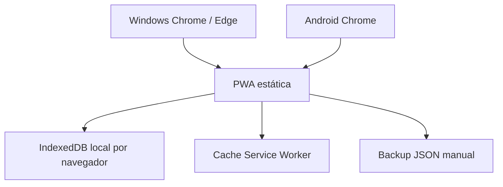
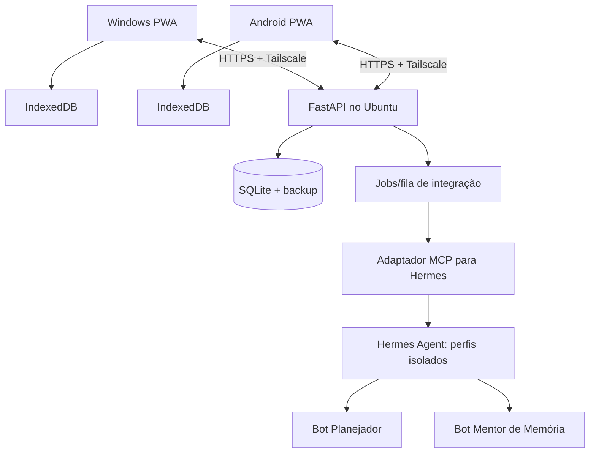

# Âncora OS — Arquitetura, riscos e integração futura com Hermes

## Arquitetura atual (implementada)



O desenho ilustra o código compartilhado entre dispositivos, **não** sincronização automática: cada navegador mantém banco próprio. O aplicativo é feito em HTML/CSS/JavaScript nativos, sem build, CDN, dependências npm ou telemetria. Custo de uso: infraestrutura opcional para hospedar arquivos estáticos, sem taxa por sessão nem uso de modelos.

## Arquitetura pretendida (NÃO implementada)



**Camada backend:** Ubuntu Server 24.04, serviço systemd dedicado e sem privilégios, FastAPI validado por esquemas tipados, SQLite em WAL, backups rotativos testados. Autenticação por identidade de dispositivo / sessão, TLS, logs sem conteúdo sensível. Tailscale para transporte privado; não publicar FastAPI, MCP ou gateway Hermes em interfaces públicas. Atenção: os dispositivos Android e Windows precisam estar na tailnet para acessar backend privado.

**Sincronização:** implementar registros versionados (id, dispositivo, updated_at, deleted_at, revisão do servidor). Usar fila de operações offline e deduplicação por operation_id; conflitos são apresentados ao usuário ou resolvidos por política explícita. O modelo atual salva o estado inteiro, portanto **precisa ser refatorado antes** de habilitar sincronização. Nunca usar 'last write wins' silenciosamente para descartar registros de trabalho.

## Atribuições de IA — fase 3

### Bot Planejador (perfil isolado)
- Lê somente títulos/estimativas/próximos passos explicitamente aprovados.
- Produz proposta de 1-3 prioridades com razão e uma primeira ação por tarefa.
- Não marca tarefas concluídas, não agenda mensagens e não move dados corporativos sem confirmação.
- Pode ser acionado manualmente ao planejar o dia; sem execução permanente.

### Bot Mentor de Memória (perfil isolado)
- Recebe apenas notas e cartões selecionados pelo usuário.
- Gera perguntas e explicações curtas, incluindo indicação de incerteza.
- Nunca altera cartões ou agenda revisões sem que o usuário aprove.
- Faz perguntas antes de fornecer respostas para favorecer recuperação ativa e autonomia.

**Por que apenas dois agentes?** Menor custo, superfície de exposição e complexidade. Se o piloto demonstrar necessidade, incluir um bot de retomada e outro de pesquisa; caso contrário, funções determinísticas são preferíveis.

**Padrão de integração preferido:** adaptador MCP local no servidor com ferramentas delimitadas, por exemplo:

- `ancora_list_tasks` — leitura de tarefas autorizadas.
- `ancora_get_context` — leitura de contexto de uma tarefa autorizada.
- `ancora_list_due_cards` — leitura de cartões autorizados.
- `ancora_propose_plan` — **proposta**, sem escrita automática.
- `ancora_propose_flashcards` — **proposta**, sem escrita automática.

O backend deve validar o escopo, auditar cada chamada e implementar rate limit. Para ações de escrita, exigir aprovação explícita na UI, independentemente do que o modelo solicitar. Uma credencial não deverá autorizar comandos de sistema, leitura de arquivos arbitrários ou consulta ao CrowdStrike.

**Documentação Hermes, consultada em out/2026:**
- https://hermes-agent.nousresearch.com/docs/user-guide/bot-mode
- https://hermes-agent.nousresearch.com/docs/user-guide/features/mcp
- https://hermes-agent.nousresearch.com/docs/user-guide/features/cron
- https://hermes-agent.nousresearch.com/docs/user-guide/security
- https://github.com/NousResearch/hermes-agent/releases

Nota: a integração concreta com MCP e perfis depende da versão efetivamente instalada. A release estável v0.22.5 é de 22/10/2026; isso não significa que a máquina do usuário já esteja atualizada. Fazer inventário, backup e testes separados antes de alterar o Hermes 24x7.

## Esboço de API para próxima etapa (CONTRATO PROPOSTO)

```text
GET    /v1/tasks
POST   /v1/tasks
PATCH  /v1/tasks/{id}
POST   /v1/focus/snapshots
GET    /v1/focus/snapshots?task_id={id}
GET    /v1/cards?due=true
POST   /v1/cards
POST   /v1/cards/{id}/reviews
POST   /v1/agent/proposals/plan
POST   /v1/agent/proposals/cards
GET    /v1/sync/changes?cursor={cursor}
POST   /v1/sync/changes
```

Contratos de modelos HTTP, autenticação, migração de esquema e implementação ficam para a etapa backend; estes endpoints **não existem no pacote atual**.

## Threat model resumido

| Risco | Efeito | Medida mínima |
|---|---|---|
| Dados corporativos misturados a dados pessoais | Vazamento / quebra de política | Espaços segregados + aprovação de uso + não importar por padrão |
| Browser / dispositivo comprometido | Exposição dos dados no IndexedDB | Criptografia de disco/OS, sessão bloqueada, não inserir segredos, futura criptografia no app |
| Dados perdidos por limpeza do browser | Esquecimento de registros e decisões | Backup manual e teste de restauração; futura sincronização privada |
| Hermes com ferramentas amplas | Escrita, exfiltração ou execução não intencional | MCP allowlist, toolsets mínimos, isolamento de perfis, aprovação humana e logs |
| Prompt injection em notas/importações | Saída enganosa / manipulação de ferramenta | Tratar conteúdo como dados não confiáveis, separar instruções, restringir ferramentas |
| Backend exposto à Internet | Ataques contra API / Hermes | Não expor; usar Tailscale, autenticação, TLS, firewall e rate limit |
| Alertas demais | Sobrecarga/distração | Notificações opt-in, digest e períodos silenciosos |
| Modificações na cadeia de suprimentos | Comprometimento do servidor de agentes | Pinagem de versões, revisão de changelog/dependências, rollback e backups |

## Observações de implementação atual

- CSP em meta tag limita scripts e conexões de rede ao próprio host; políticas como `frame-ancestors` exigem header HTTP se necessárias.
- As entradas de texto são apresentadas com escaping HTML; importação JSON tem validação básica de tipo, tamanho e versão.
- A persistência é local, sem autenticação própria, sem criptografia aplicada pelo aplicativo.
- Não há aquisição de dados de saúde ou inferência clínica.
- A PWA não emite notificações em background; o timer não garante alarme quando a tela está bloqueada.
- Antes de ambiente real, rodar testes E2E e auditoria de segurança e privacidade.
